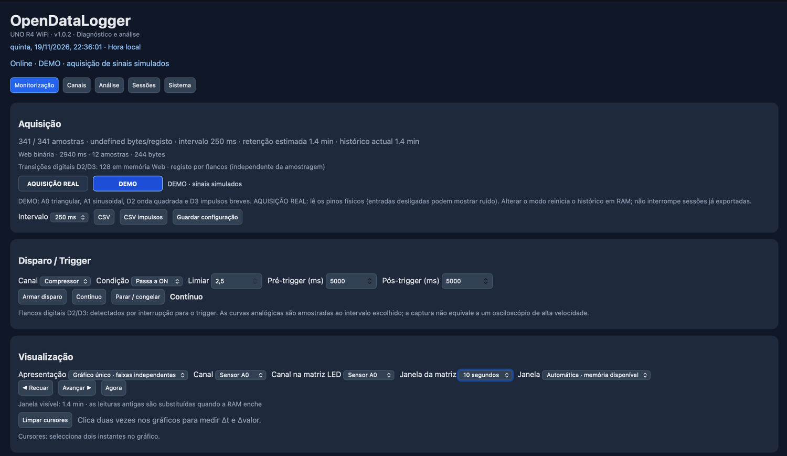
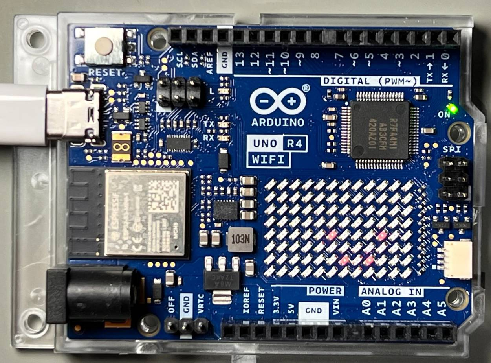
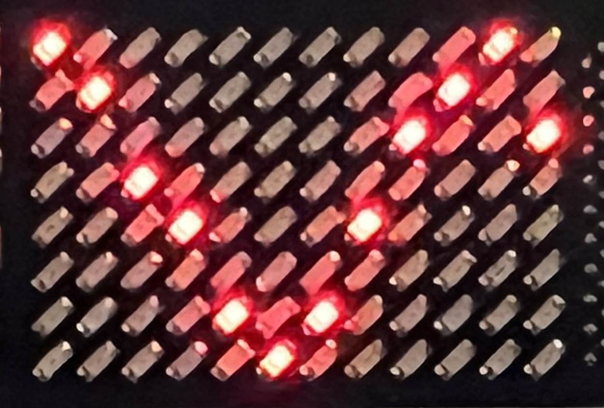
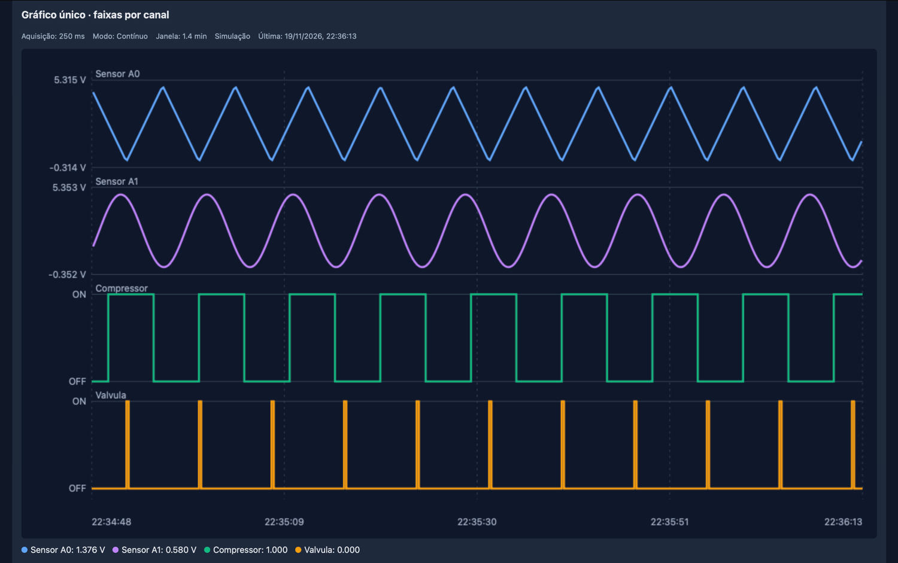
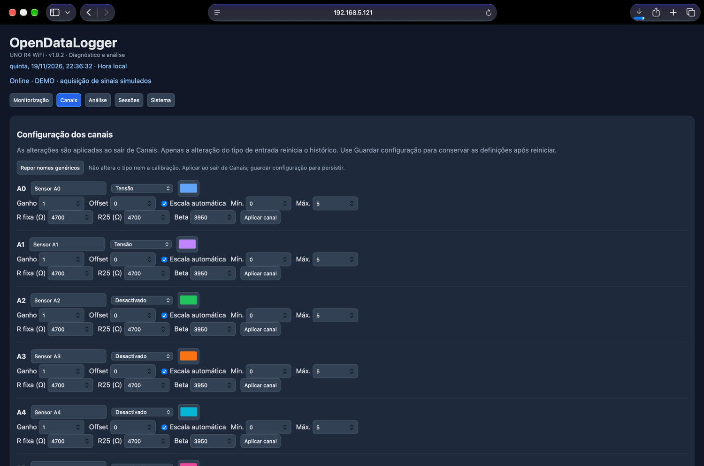
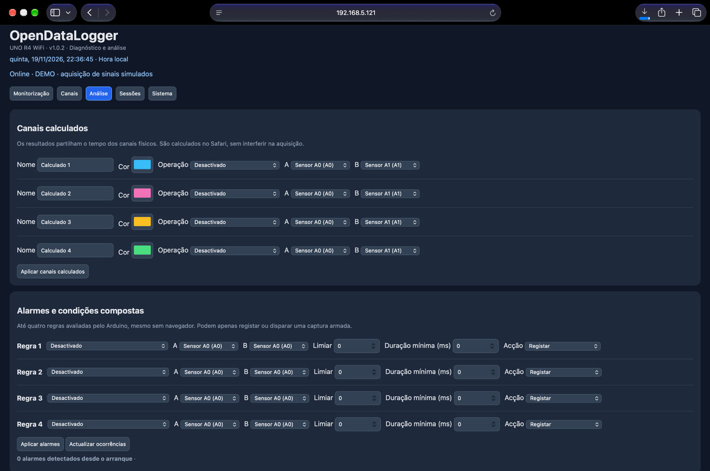
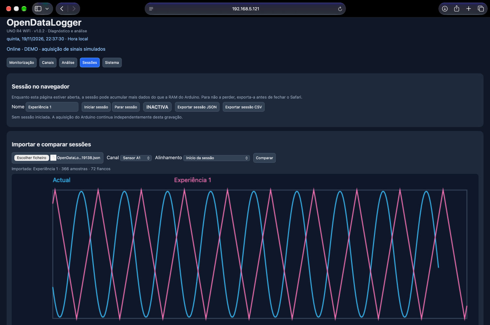
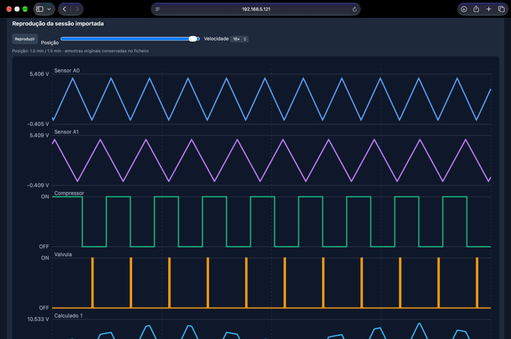
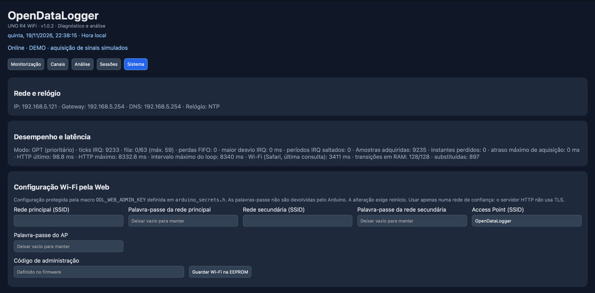

# OpenDataLogger

**A configurable, open-source, browser-based data logger for Arduino UNO R4 WiFi.**

**Made by Ricardo Oitavén & Eyla IA** · MIT License · Experimental v1.0.3

**English (default)** · [Português](README.pt.md) · [Source code](OpenDataLogger.ino) · [Security](SECURITY.md)

OpenDataLogger acquires analogue signals and digital transitions on a shared timeline, presents them in a local Web interface, and supports live inspection, capture, session recording, playback and analysis. Channel names and uses are configurable: this is a **general-purpose instrument**, not a device dedicated to one application.

> **Project status:** Experimental. The Web interface and parts of the firmware have been exercised, but not every configuration has been validated on physical hardware. **Not a certified measurement or safety device.** Never connect mains voltage directly to the Arduino; use appropriately rated, isolated interfaces.

*Figure 1 — Live monitoring, with a common acquisition interval, trigger settings and configurable display modes. Screenshot from an experimental build; labels and layout may evolve.*

## Features

- **Priority acquisition:** a hardware-timer-based sampling path and a ring-buffer queue designed to keep acquisition separate from Web serving.
- **Analogue channels:** A0–A5, configurable input types, gain, offset, manual/automatic scaling and NTC conversion.
- **Digital channels:** D2–D3 edge detection, timestamps, pulse tracking and digital history independent of the periodic analogue sampling interval.
- **Multiple displays:** individual, responsive and vertically stacked charts, overlaid channels and a single chart with independent lanes sharing one time axis.
- **LED matrix:** selectable channel, a compact 12×8 time plot and 1 / 3 / 10 / 30-second windows.
- **Analysis:** cursors, calculated channels, configurable alarms, cycle statistics and NTC calibration.
- **Web sessions:** accumulate a longer session while the page is open, export JSON/CSV, import recordings, replay and compare sessions.
- **Local storage:** microSD support prepared with startup detection, but requires separate hardware validation.
- **Local networking:** Wi-Fi setup through the Web interface and fallback access-point mode; administration should be restricted to trusted networks.

## Hardware and LED matrix

| Arduino UNO R4 WiFi | 12×8 LED time plot |
|:--:|:--:|
|  |  |

*Figure 2 — The hardware and its LED-matrix signal display. With only 12 horizontal positions, the matrix is a quick visual indicator, **not** a high-resolution oscilloscope. A window close to the signal period often gives the clearest result.*

## Live signal visualisation

All displayed channels use a shared time reference. The selected chart mode changes the presentation, not the underlying samples. Short digital pulses are reconstructed from recorded edges rather than relying solely on periodic analogue snapshots.

*Figure 3 — One chart, independent signal lanes and a common time axis. Channel names shown in the example are user-defined.*

## Configure channels

Names, colours, input types, scaling and calibration parameters are adjustable in the **Channels** tab. Starting values can be defined in `ChannelDefaults.h`; saved EEPROM settings take precedence after a restart.

*Figure 4 — Configurable channels; no channel name implies a fixed application.*

## Calculated channels, alarms and analysis

Calculated channels inherit the time axis of their source channels. The **Analysis** tab includes configurable calculations, alarm conditions, event counts and calibration controls. Processing and visualisation do not modify raw samples.

*Figure 5 — Virtual channels and configurable alarm rules.*

## Record, replay and compare sessions

A Web session can accumulate samples and edges while the page remains open. Export it before closing or refreshing the page: the browser-side session is **not persistent storage**. JSON and CSV import/export help share experiments, and replay makes it possible to inspect an earlier acquisition again.

*Figure 6 — Starting a session and comparing it with an imported recording.*

*Figure 7 — Session playback with multiple independent channels.*

## System diagnostics and Wi-Fi

The **System** tab reports networking, acquisition health, ring-buffer capacity and timing indicators. When changing the number of active channels or the acquisition interval, the reported maximum record count and estimated retention interval change accordingly.

*Figure 8 — Diagnostics and Wi-Fi configuration. Example private IP addresses in the screenshot are not public service endpoints.*

## Getting started

1. Install **Arduino IDE 2** and the **Arduino UNO R4 Boards** package; select **Arduino UNO R4 WiFi**.
2. Clone this repository, or use **Code → Download ZIP**. Ensure all `.ino` and `.h` files are in a folder called `OpenDataLogger`, with `OpenDataLogger.ino` at its root.
3. Copy `arduino_secrets.h.example` to `arduino_secrets.h`. Supply private Wi-Fi/AP credentials and a strong `ODL_WEB_ADMIN_KEY` (at least 12 characters) if Web Wi-Fi configuration is required. The real secrets file is ignored by Git.
4. Open `OpenDataLogger.ino` and choose **Verify** followed by **Upload**. Check the Serial Monitor (115200 baud) for the local address.
5. Connect to the local Web interface. Select **DEMO** to explore the UI without sensors, or **REAL ACQUISITION** to read the physical pins.
6. Use **Channels** to configure inputs, **Monitoring** to visualise, **Analysis** to evaluate and **Sessions** to export recorded experiments.

> **Migration tip:** if you already have an `OpenDataLogger` folder, back it up and use a clean new folder rather than copying files over older versions. Keep your existing `arduino_secrets.h` separately; never commit it.

## Data model and limits

The firmware maintains a 4,096-byte rolling sample buffer; the number of records depends on the active physical channels. At four active channels, a record uses 12 bytes, giving approximately 341 records (about 34 seconds at 100 ms, or about 85 seconds at 250 ms). Digital edge history uses a separate finite buffer. Browser sessions extend the *visible* history while connected but cannot reconstruct samples lost during a long disconnection.

The analogue acquisition period is common across active analogue channels; edge-triggered digital event capture operates independently. The microSD module is optional and has **not yet been fully validated** on the target hardware. Timing and pulse accuracy must be verified for each measurement application.

## Security and contribution

The embedded server is designed for trusted local networks; **HTTP traffic is not encrypted**. Avoid exposing the device to the public Internet. Do not connect high voltage directly to its pins. Review [SECURITY.md](SECURITY.md), [CONTRIBUTING.md](CONTRIBUTING.md) and the [test plan](TEST_PLAN_1.0.2.md) before deployment or contributions.

Code comments and identifiers are intended to be **English-only**; documentation is maintained in **English (default) and Portuguese**. The screenshots were captured using a Portuguese-language interface and configurable demonstration profiles.

**Made by Ricardo Oitavén & Eyla IA** · [MIT License](LICENSE)
