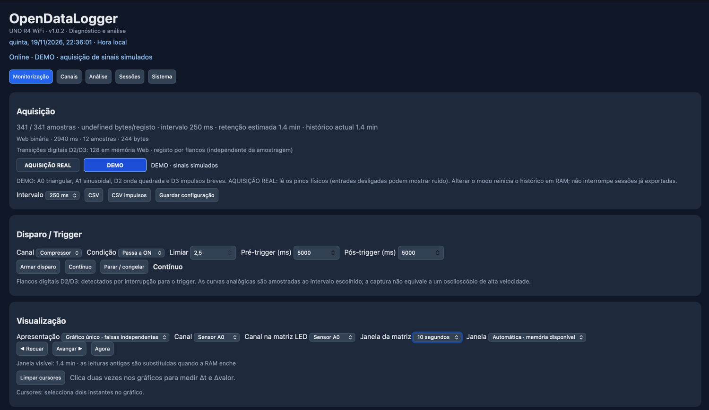
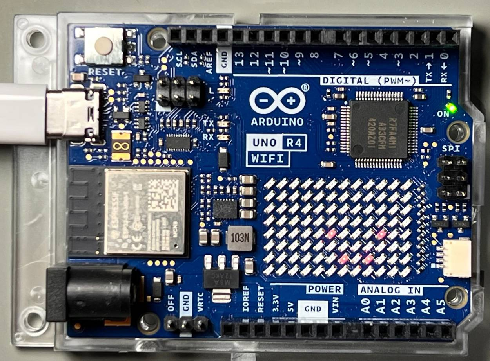
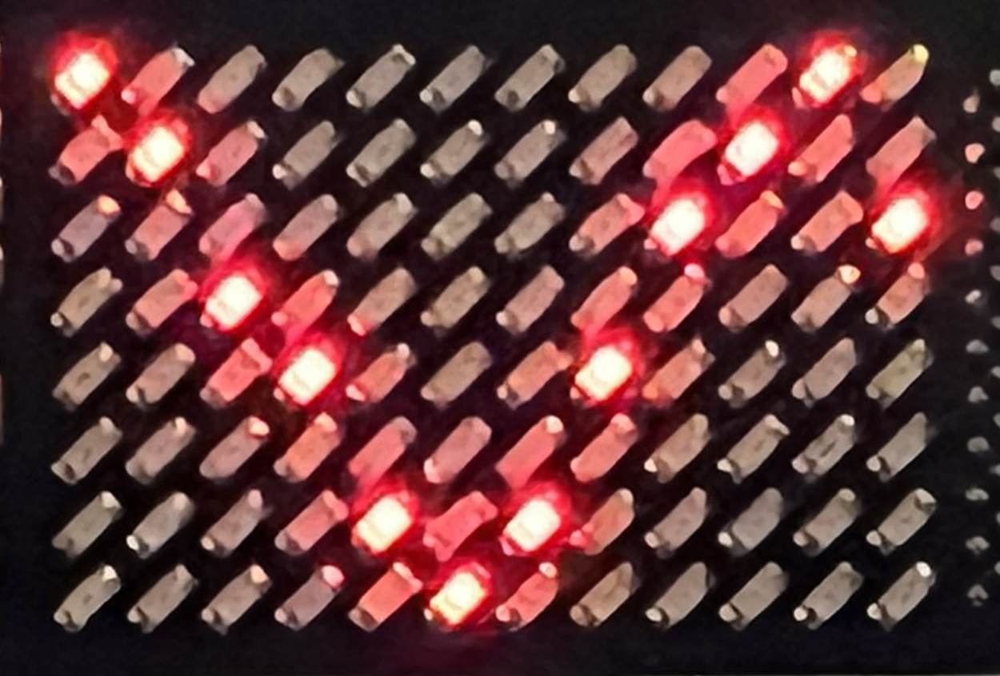
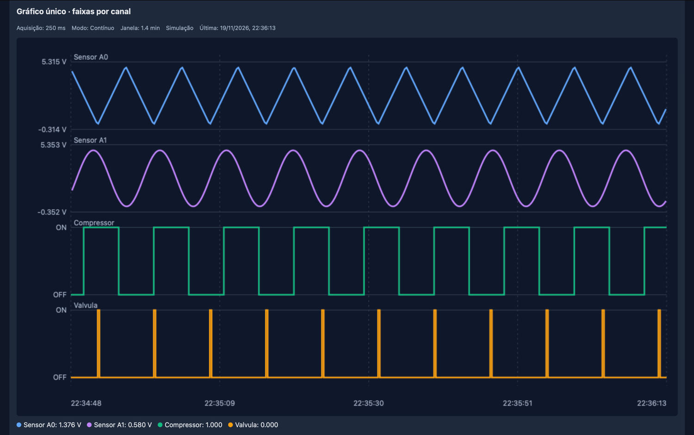
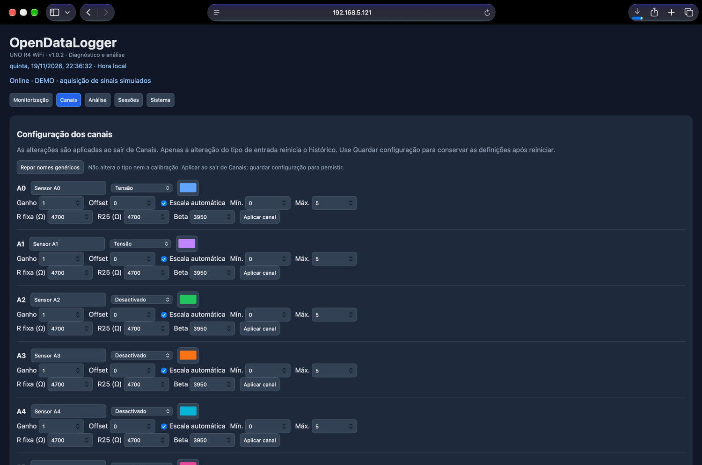
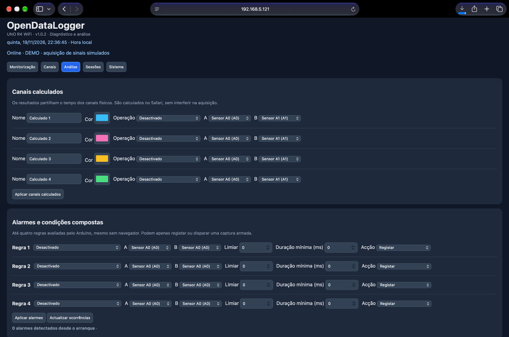
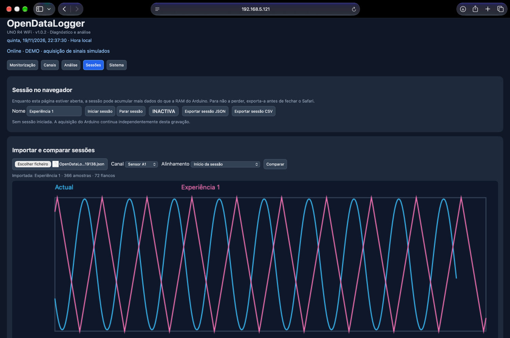
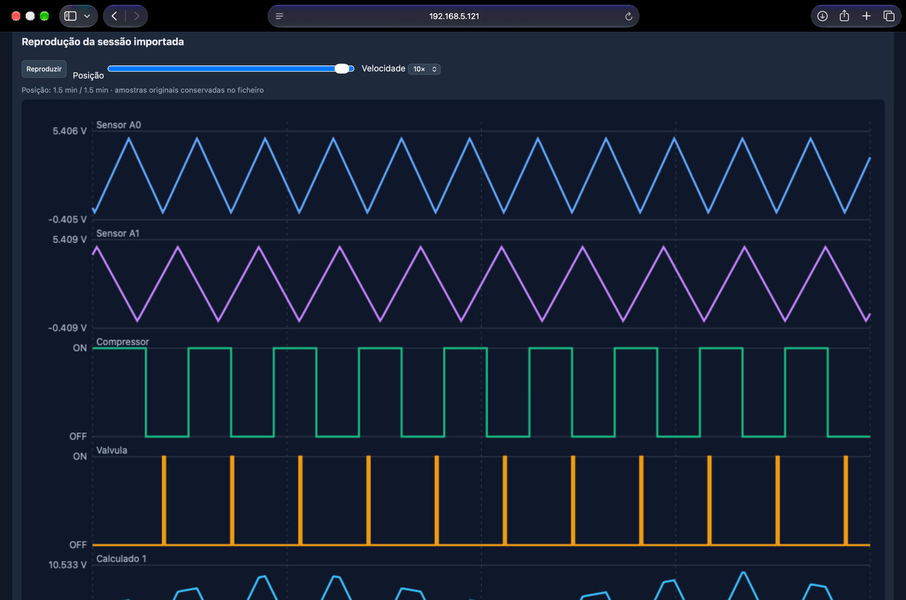
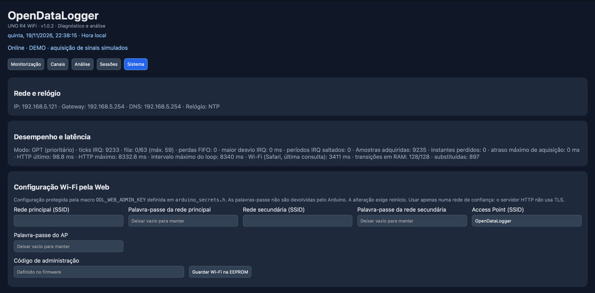

# OpenDataLogger

**Data logger genérico, open source e com interface Web para Arduino UNO R4 WiFi.**

**Made by Ricardo Oitavén & Eyla IA** · Licença MIT · Versão experimental 1.0.3

[English (predefinido)](README.md) · **Português** · [Código-fonte](OpenDataLogger.ino) · [Segurança](SECURITY.md)

O OpenDataLogger adquire sinais analógicos e transições digitais com uma referência temporal comum, apresenta-os numa interface Web local e permite monitorizar, capturar, gravar sessões, reproduzir experiências e analisar os dados. Os nomes e as aplicações dos canais são configuráveis: trata-se de um **instrumento de uso geral**.

> **Estado do projecto:** Experimental. A interface Web e componentes do firmware já foram ensaiados, mas nem todas as configurações estão validadas em hardware. **Não é um instrumento de medição certificado nem um dispositivo de segurança.** Nunca ligar directamente tensão da rede eléctrica ao Arduino; utilizar interfaces isoladas e devidamente dimensionadas.

*Figura 1 — Monitorização com intervalo de aquisição comum, disparo e modos de visualização configuráveis. Captura de uma versão experimental; o aspecto pode evoluir.*

## Funcionalidades

- **Aquisição prioritária:** temporizador de hardware e fila circular para separar a aquisição do servidor Web.
- **Canais analógicos:** A0–A5, tipos configuráveis, ganho, offset, escalas automáticas/manuais e conversão NTC.
- **Canais digitais:** D2–D3, detecção de flancos, registo temporal e histórico de impulsos independente da amostragem analógica periódica.
- **Modos gráficos:** gráficos individuais, adaptativos e verticais, canais sobrepostos e gráfico único por faixas com eixo temporal comum.
- **Matriz LED:** canal seleccionável, gráfico compacto de 12×8 pontos e janelas de 1 / 3 / 10 / 30 segundos.
- **Análise:** cursores, canais calculados, alarmes, estatísticas de ciclos e calibração NTC.
- **Sessões Web:** acumulação de dados enquanto a página está aberta, exportação JSON/CSV, importação, reprodução e comparação.
- **Armazenamento:** suporte microSD preparado com detecção no arranque; falta a validação do módulo físico.
- **Rede local:** configuração de Wi-Fi pela Web e modo Access Point de recurso, apenas em redes de confiança.

## Hardware e matriz LED

| Arduino UNO R4 WiFi | Gráfico temporal de 12×8 LEDs |
|:--:|:--:|
|  |  |

*Figura 2 — O hardware e a visualização na matriz LED. Com apenas 12 posições horizontais, a matriz é um indicador rápido, **não** um osciloscópio de alta resolução. Uma janela próxima do período do sinal permite uma leitura mais clara.*

## Visualização de sinais em tempo real

Todos os canais partilham a mesma referência temporal. O modo gráfico modifica apenas a apresentação, não as amostras. Os impulsos digitais curtos são reconstruídos a partir das transições registadas, e não apenas das leituras analógicas periódicas.

*Figura 3 — Gráfico único, faixas independentes e eixo temporal comum. Os nomes dos canais são definidos pelo utilizador.*

## Configuração dos canais

Nomes, cores, tipos de entrada, escalas e calibração são configuráveis no separador **Canais**. Os valores iniciais podem ser definidos em `ChannelDefaults.h`; as configurações guardadas na EEPROM prevalecem após o reinício.

*Figura 4 — Canais totalmente configuráveis, sem significados predefinidos para cada aplicação.*

## Canais calculados, alarmes e análise

Os canais calculados utilizam a referência temporal dos canais de origem. O separador **Análise** inclui operações calculadas, regras de alarme, contagem de eventos e calibração. Os dados originais não são modificados pela apresentação.

*Figura 5 — Canais virtuais e regras de alarme configuráveis.*

## Gravar, reproduzir e comparar sessões

Uma sessão Web pode acumular amostras e flancos enquanto a página estiver aberta. É necessário exportá-la antes de fechar ou actualizar a página: a sessão no navegador **não substitui armazenamento persistente**. A importação/exportação JSON e CSV permite partilhar experiências e voltar a analisar aquisições anteriores.

*Figura 6 — Início de sessão e comparação com uma gravação importada.*

*Figura 7 — Reprodução de uma sessão com sinais analógicos e digitais.*

## Sistema, desempenho e Wi-Fi

O separador **Sistema** apresenta estado da rede, saúde da aquisição, capacidade da memória circular e indicadores de temporização. Ao alterar os canais activos ou o intervalo de aquisição, o número máximo de registos e o tempo estimado de retenção são recalculados.

*Figura 8 — Diagnósticos e configuração Wi-Fi. Os endereços privados apresentados são apenas exemplos locais.*

## Instalação

1. Instalar o **Arduino IDE 2** e o pacote de placas **Arduino UNO R4 Boards**; seleccionar **Arduino UNO R4 WiFi**.
2. Clonar o repositório ou escolher **Code → Download ZIP**. Todos os ficheiros `.ino` e `.h` devem ficar na pasta `OpenDataLogger`, com `OpenDataLogger.ino` na raiz.
3. Copiar `arduino_secrets.h.example` para `arduino_secrets.h` e introduzir as credenciais privadas da rede e do Access Point. Definir uma chave forte `ODL_WEB_ADMIN_KEY` (mínimo 12 caracteres) para permitir a configuração Wi-Fi pela Web. Este ficheiro não deve ser enviado para o Git.
4. Abrir `OpenDataLogger.ino` e escolher **Verify** e depois **Upload**. Verificar o endereço da rede no Serial Monitor (115200 baud).
5. Aceder à interface Web local e escolher **DEMO**, para explorar sem sensores, ou **AQUISIÇÃO REAL**, para utilizar os pinos físicos.
6. Utilizar **Canais** para configurar, **Monitorização** para observar, **Análise** para avaliar e **Sessões** para exportar experiências.

> **Migração:** se já existir uma pasta `OpenDataLogger`, guardar uma cópia e utilizar uma pasta nova, para não misturar ficheiros de versões distintas. Preservar `arduino_secrets.h` separadamente e nunca publicá-lo.

## Dados e limitações

O firmware reserva 4.096 bytes para o histórico circular de amostras; a capacidade depende do número de canais físicos activos. Com quatro canais, um registo ocupa 12 bytes e cabem aproximadamente 341 registos (cerca de 34 segundos a 100 ms ou 85 segundos a 250 ms). As transições digitais têm uma memória circular independente e finita. As sessões Web prolongam o histórico visível, mas não reconstituem dados perdidos numa desconexão longa.

A frequência de aquisição analógica é comum aos canais activos; a detecção de flancos digitais é independente. O microSD é opcional e **ainda não está totalmente validado** no hardware. A precisão temporal e a detecção de impulsos devem ser verificadas para cada aplicação.

## Segurança e contribuições

O servidor destina-se a redes locais de confiança; **o HTTP não é cifrado**. Não expor o Arduino directamente à Internet. Não ligar alta tensão aos pinos. Consultar [SECURITY.md](SECURITY.md), [CONTRIBUTING.md](CONTRIBUTING.md) e o [plano de testes](TEST_PLAN_1.0.2.md) antes de utilizar ou contribuir.

Os comentários e identificadores de código devem estar **apenas em inglês**; a documentação pública é mantida em **inglês (predefinido) e português**. As capturas mostram uma interface em português e perfis de demonstração configuráveis.

**Made by Ricardo Oitavén & Eyla IA** · [Licença MIT](LICENSE)
